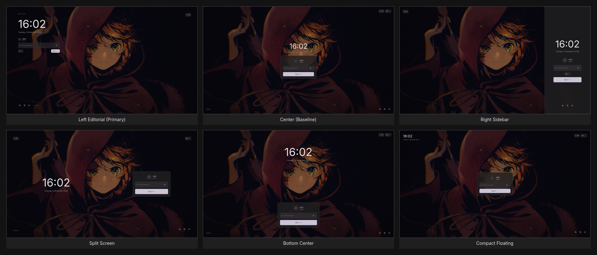
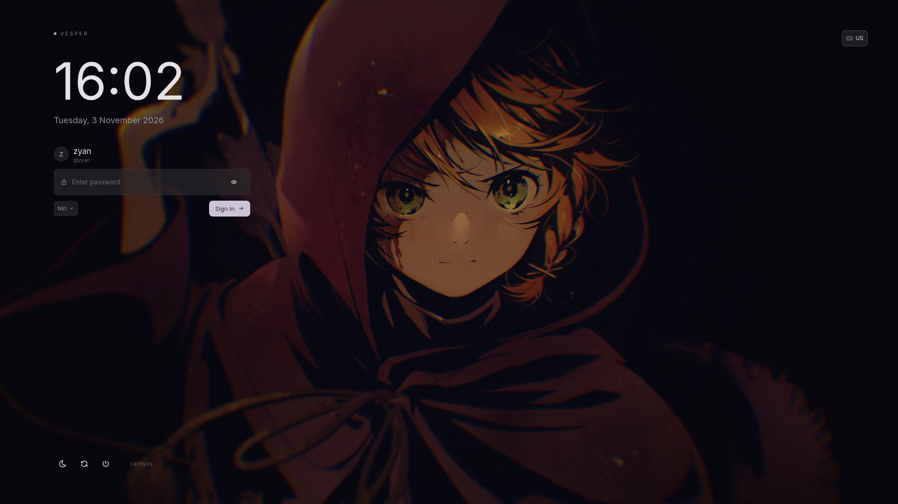
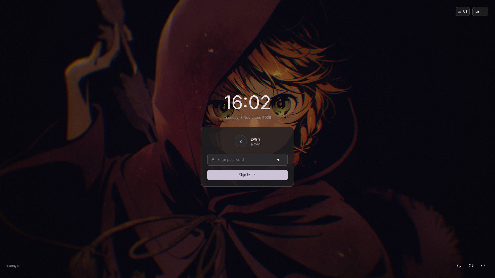
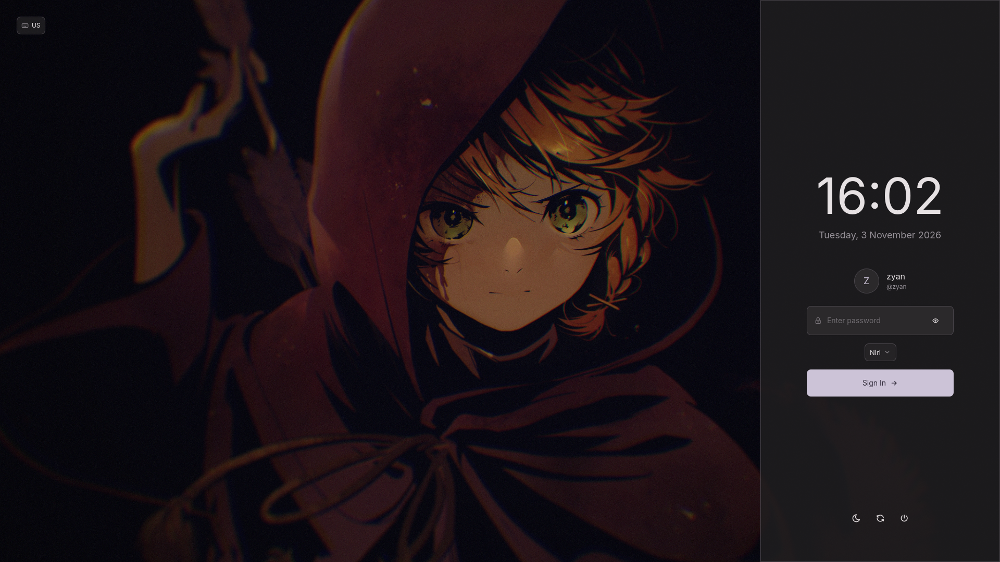
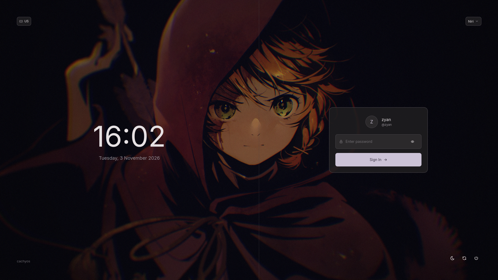
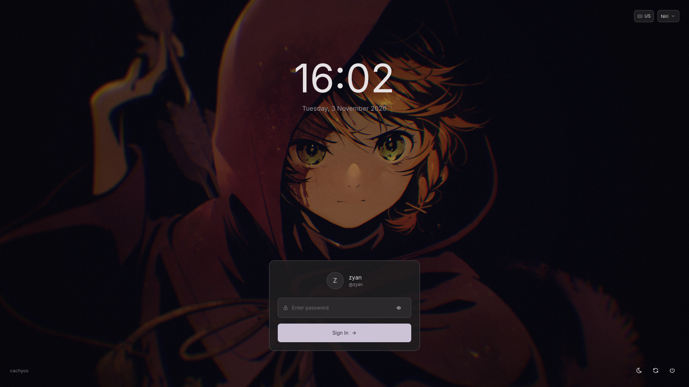
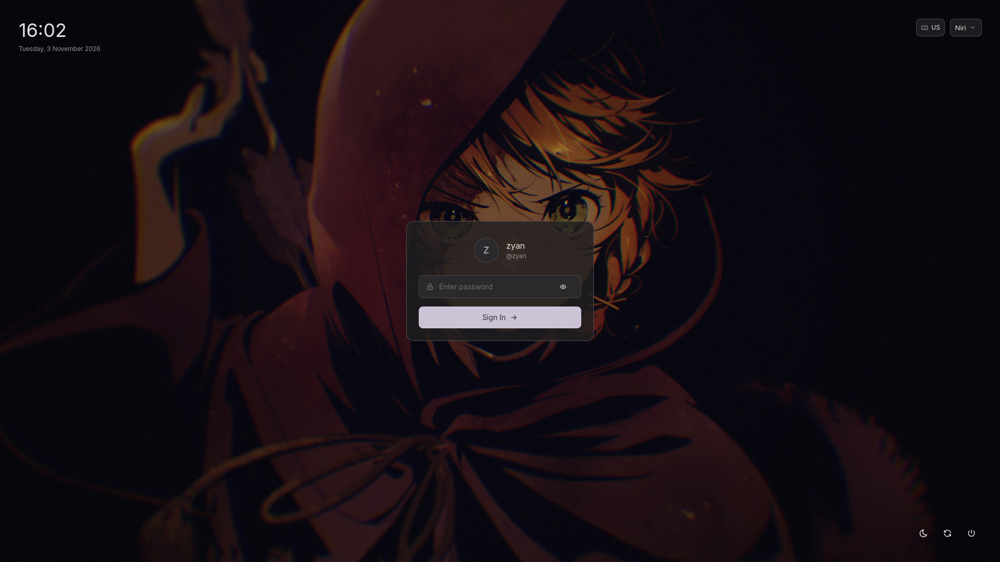

# VESPER

### A Minimal, Adaptive SDDM Theme
> *A quieter way into your desktop.*

[](https://github.com/sddm/sddm)
[](https://www.qt.io/)
[](LICENSE)

---

**VESPER** is an independent, production-ready login theme for SDDM (Simple Desktop Display Manager) built with Qt 6 QML. Designed around editorial typography, negative space, and semantic color adaptation, VESPER removes conventional login card clutter and lets your desktop wallpaper set the atmosphere.



---

## 1. Features

- **Minimalist & Editorial:** No bloated containers, aggressive drop-shadows, or synthetic gradients. Typography and spacing establish visual hierarchy.
- **Adaptive Color Engine:** Extracts semantic color tokens dynamically from active wallpapers or desktop settings, with automatic high-contrast fallbacks.
- **Six Modular Layouts:** Easily switch between editorial, centered, split-screen, sidebar, bottom, or compact floating interfaces.
- **Native SDDM Integration:** Built strictly against official SDDM Qt 6 APIs (`sddm.login()`, `sessionModel`, `userModel`, `keyboard`).
- **Autonomous & Resilient:** Requires no background daemons at login. Reads static palettes and local wallpapers reliably before user sessions start.
- **Session & Power Controls:** Complete Wayland/X11 session picker, keyboard layout selector, and system suspend/reboot/shutdown controls.
- **Fluid & Non-intrusive:** Subtle micro-interactions, password visibility toggle, hardware Caps Lock detection, and error shake feedback without interfering with keyboard response.

---

## 2. Layout Gallery

VESPER comes equipped with six distinct, fully responsive layout architectures:

### ✦ Left Editorial (`left-editorial`) — *Primary Default*
Asymmetric editorial composition with prominent typography and left-aligned controls, preserving generous negative space for wallpaper artwork.


---

### ✦ Center (`center`) — *Baseline Regression*
Classic centered card composition with a large digital clock stacked cleanly above the authentication panel.


---

### ✦ Right Sidebar (`right-sidebar`)
Full-height vertical sidebar docked along the right viewport edge containing the clock, login form, and power controls.


---

### ✦ Split Screen (`split-screen`)
Balanced dual-pane layout featuring an ambient time display across the left half and interactive login controls on the right.


---

### ✦ Bottom Center (`bottom-center`)
Floating digital clock positioned in the upper viewport with compact authentication controls docked neatly along the bottom edge.


---

### ✦ Compact Floating (`compact-floating`)
Minimal floating authentication card with a discrete independent clock in the upper-left corner for maximum wallpaper visibility.


---

## 3. Requirements

- **Linux** (tested on CachyOS / Arch Linux with Niri Wayland session)
- **SDDM 0.20+** or **0.21+** configured for Qt 6 greeter (`sddm-greeter-qt6`)
- **Qt 6 Declarative** (`qt6-declarative`, `qt6-svg`)
- **Python 3.11+** (used by the color synchronization tool)

### Optional Dependencies (for Headless Screenshot Rendering)
- **C++17 Compiler & Qt 6 Development Headers** (`g++` or `clang`, `qt6-base`, `qt6-declarative`, `pkg-config`)
- **ImageMagick 7+** (optional, used for assembling composite gallery overviews)

---

## 4. Preview & Offline Rendering

### Interactive Preview
You can safely test VESPER in a windowed sandbox inside your active graphical desktop without modifying system display manager configurations:

```bash
# Preview primary layout (left-editorial)
./preview.sh

# Preview any layout variant using sandboxed override
./preview.sh --layout center
./preview.sh --layout right-sidebar
./preview.sh --layout split-screen
./preview.sh --layout bottom-center
./preview.sh --layout compact-floating
```

### Headless Screenshot Rendering
VESPER includes a built-in offscreen renderer to generate pixel-perfect 1920x1080 screenshots of any layout without requiring an external monitor:

```bash
./preview.sh --layout left-editorial --screenshot docs/screenshots/left-editorial.png
```

---

## 5. Installation

To install VESPER to your system display manager directory:

```bash
sudo ./install.sh
```

### What `install.sh` does:
1. Backs up any pre-existing `/usr/share/sddm/themes/vesper` installation.
2. Synchronizes your current desktop wallpaper and adaptive palette.
3. Copies all assets, layouts, and components to `/usr/share/sddm/themes/vesper/`.
4. Sets standard world-readable file permissions (`755` for directories, `644` for files).
5. Backs up `/etc/sddm.conf.d/theme.conf` to `/etc/sddm.conf.d/backups/`.
6. Sets `Current=vesper` in `/etc/sddm.conf.d/theme.conf`.
7. Installs the `/usr/local/bin/vesper-sddm-sync` helper utility.

---

## 6. Switching Layouts

To change your active layout after installation, edit `layout` in `/usr/share/sddm/themes/vesper/theme.conf`:

```ini
[General]
layout=left-editorial
```

*Allowed values:* `left-editorial`, `center`, `right-sidebar`, `split-screen`, `bottom-center`, `compact-floating`.

---

## 7. Dynamic Color Synchronization

VESPER uses nine semantic color tokens:

| Token | Semantic Role | Fallback Hex |
| :--- | :--- | :--- |
| `background` | Fullscreen background base | `#141314` |
| `surface` | Container and elevated surfaces | `#201f20` |
| `surfaceAlt` | Interactive input fields & dropdowns | `#2b292b` |
| `foreground` | High-contrast text & primary icons | `#e6e1e3` |
| `muted` | Secondary text, date, & subtle outlines | `#948f96` |
| `accent` | Primary action highlights & focus rings | `#ccc3d7` |
| `accentForeground` | Text on top of accent surfaces | `#342e3d` |
| `border` | Hairline borders & separators | `#49454b` |
| `error` | Authentication failure notifications | `#ffb4ab` |

Whenever you update your desktop wallpaper or color scheme:

```bash
sudo vesper-sddm-sync
```

Or run the script directly:
```bash
/usr/share/sddm/themes/vesper/sync/sync-colors.sh /usr/share/sddm/themes/vesper
```

---

## 8. Wallpaper Configuration

By default, color synchronization copies your active wallpaper to `assets/background.png` inside the theme directory with `644` permissions so the unprivileged `sddm` user can read it.

To manually specify a static wallpaper, edit `background` in `theme.conf`:

```ini
[General]
background=assets/background.png
dimBackground=0.25
```

---

## 9. Rollback & Recovery

To revert to your previous SDDM theme at any time:

```bash
sudo ./rollback.sh
```

### Emergency TTY Recovery
If SDDM fails to start after an operating system upgrade:
1. Switch to a virtual terminal with `Ctrl + Alt + F3`.
2. Log in with your username and password.
3. Run the rollback script:
   ```bash
   sudo /path/to/vesper-sddm/rollback.sh
   sudo systemctl restart sddm
   ```

---

## 10. Troubleshooting

- **SDDM greeter shows a black screen:**
  Ensure the wallpaper in `/usr/share/sddm/themes/vesper/assets/background.png` has world-readable permissions (`chmod 644`). The SDDM greeter runs as user `sddm` and cannot access files locked to your personal home directory.
- **Icons are missing or showing squares:**
  Verify that `assets/fonts/tabler-icons.ttf` exists and is readable.
- **Login fails or username is incorrect:**
  If your system has no active users indexed by AccountsService, VESPER automatically presents a manual username input field.

---

## 11. Project Architecture

```
vesper/
├── metadata.desktop          # SDDM Qt6 Greeter theme metadata
├── Main.qml                  # Root display manager view & signal routing
├── theme.conf                # SDDM properties & active color tokens
├── palette.json              # Serialized semantic color tokens
├── preview.sh                # Windowed testing runner & 1080p renderer
├── install.sh                # Safe system installer with automated backups
├── rollback.sh               # System restoration utility
├── assets/
│   ├── background.png        # Active wallpaper copy (world-readable)
│   ├── fonts/                # Bundled typography assets
│   │   ├── Inter.ttf         # SIL OFL 1.1 font
│   │   └── tabler-icons.ttf  # Tabler vector glyph font
│   ├── icons/                # Standalone SVG icons
│   └── preview/              # Historical preview media
├── components/
│   ├── Colors.qml            # Reactive color token loader & fallbacks
│   ├── Clock.qml             # Tabular digital clock & formatted date
│   ├── Icon.qml              # Vector glyph renderer
│   ├── IconButton.qml        # Interactive button with hover feedback
│   ├── UserSelector.qml      # User identity & multi-user support
│   ├── PasswordInput.qml     # Password field with reveal & CapsLock
│   ├── SessionSelector.qml   # Wayland/X11 session picker
│   ├── KeyboardSelector.qml  # Keyboard layout indicator
│   ├── PowerBar.qml          # Suspend, Reboot, and PowerOff actions
│   └── LoginPanel.qml        # Authentication form & error feedback
├── docs/
│   └── screenshots/          # 1920x1080 layout gallery screenshots
│       ├── layout-gallery.png
│       ├── left-editorial.png
│       ├── center.png
│       ├── right-sidebar.png
│       ├── split-screen.png
│       ├── bottom-center.png
│       └── compact-floating.png
├── layouts/
│   ├── LeftEditorial.qml     # Primary editorial layout
│   ├── CenterLayout.qml      # Baseline centered layout
│   ├── RightSidebar.qml      # Docked sidebar layout
│   ├── SplitScreen.qml       # Dual-pane balanced layout
│   ├── BottomCenter.qml      # Bottom docked layout
│   └── CompactFloating.qml   # Floating dialog layout
└── sync/
    ├── sync-colors.sh        # Wallpaper & adaptive color sync script
    ├── render-screenshot.cpp # Offscreen 1080p QML renderer source
    └── vesper-sddm-sync.service # Systemd service unit
```

---

## 12. Disclaimer

**VESPER is an independent open-source project.** It is not affiliated with, endorsed by, or a component of Noctalia Shell or any desktop environment. It operates autonomously on standard SDDM installations.

---

## 13. Credits & Third-Party Licenses

- **VESPER:** Licensed under the [MIT License](LICENSE). Copyright (c) 2026 Zyan.
- **Inter Font:** Designed by Rasmus Andersson. Licensed under the [SIL Open Font License 1.1](https://scripts.sil.org/OFL).
- **Tabler Icons:** Designed by Paweł Kuna. Licensed under the [MIT License](https://github.com/tabler/tabler-icons/blob/master/LICENSE).
- **SDDM:** Simple Desktop Display Manager team.
